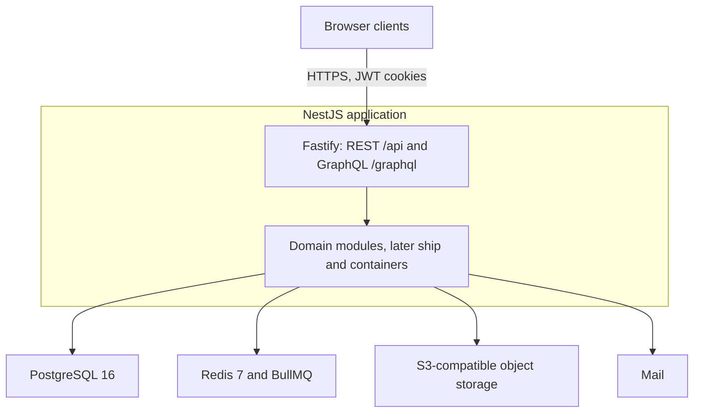
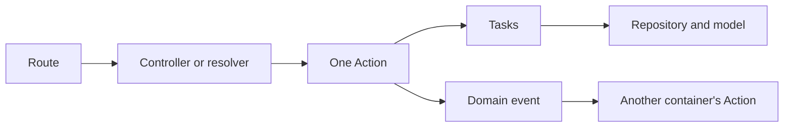

# Unimap architecture

Unimap is indoor navigation for a university. This document records the structures that host the product. Role behavior is specified in [spec.md](spec.md). Failure mapping is specified in [error-handling.md](error-handling.md). Concurrent work is specified in [concurrency.md](concurrency.md).

The thesis, the diploma presentation, the Unimap 2.0 presentation, and the specification draft share the map graph and the publication gate. The thesis describes the stage-1 DDD-lite modules. The Unimap 2.0 presentation and the specification draft describe the later Porto layout. They do not agree on the points in [Unresolved structure](#unresolved-structure). No choice is recorded for those points, so this document states each side and does not adopt one of them.

## Unresolved structure

### Workspaces

The thesis describes two npm workspaces, `apps/api` and `apps/web`. The Unimap 2.0 stage-1 summary, marked done, and the specification draft add a third Next.js application, `apps/admin`. The diploma presentation describes an administrator interface and does not name a workspace. Every source includes an administrator interface. The packaging of that interface is open.

### Process boundary

The diploma presentation lists client-server delivery, a monorepo, and microservices together as the architecture. The thesis describes one API application and one web client, with domain modules inside that API. The Unimap 2.0 presentation describes a modular monolith and treats a Porto section as a later service boundary, for example navigation if route search dominates the process. The specification draft keeps the first slices as one NestJS process and places extraction of a section outside those slices. The process boundary is open.

### Administrator surface

The thesis limits administration to buildings, floors, maps, rooms, and events. The diploma presentation adds an account list, role changes, and account deletion. The Unimap 2.0 stage-1 admin surface, marked done, and the specification draft add those account operations and also an audit of administrator actions and client-log intake. The thesis module list does not name client logs. The administrator surface is open.

### History ownership

Search history and route history are rows attached to a user. The thesis role section and the thesis history section keep a temporary history on the guest account. The specification draft does the same for a guest session and stores a successful path for a signed-in account. The thesis use-case section and the thesis history panel withhold a stored history until sign-in. [error-handling.md](error-handling.md) attaches personal history, including a stored successful route, to a registered user and withholds that history from a guest. The Unimap 2.0 stage-1 user surface lists history for students and guests and does not split guest from registered user. The owning account is open.

In the stage-2 layout, wayfinding emits a route-found event and history handles it. Wayfinding does not import history's repository. Which account that handler may write waits on this choice.

### Saved items and events

The Unimap 2.0 stage-1 user surface, marked done, lets students and guests save rooms and routes and create personal events. The diploma presentation lists viewing and creating events as a user-facing capability and lists creation of global events for the administrator. The thesis and the specification draft let every visitor view university events, let an administrator create those events, and let a registered user save rooms and routes. They describe no personal-event record. [error-handling.md](error-handling.md) attaches saved rooms and routes to a registered user and attaches university-event creation to an administrator. The saved-item rule and the event model are open.

## Runtime topology



Browser clients reach a NestJS 11 application on Fastify. REST lives under `/api`. GraphQL lives under `/graphql` through Mercurius, and DataLoader batches aggregated reads. A throttle guard sits on the HTTP adapter. Zod validates configuration before the process serves traffic. A health route reports process liveness. How that application is divided across server processes is the open process boundary.

The visitor client is Next.js 15 on React 19 and the App Router. It shares the API, the cookie session, and the visual language of Tailwind CSS 4 with Material Design 3 tokens. Ukrainian and English use next-intl with locale routing. The public map lives in this client. The administrator interface exists in every source. Its workspace and its operation set are open.

PostgreSQL 16 holds relational data and the floor graph as JSONB. Redis 7 holds the BullMQ queue. Object storage holds SVG bytes. Local composition uses MinIO and a mail catcher. The API issues short-lived signed URLs for SVG sources. The visitor client loads a floor through its own server route so the browser session stays on the application origin.

TypeScript strict mode, Node.js LTS, npm workspaces, Drizzle, ESLint, Prettier, and Jest cover the monorepo.

## Stage-1 shape inside the API

The NestJS application starts as a feature-first, DDD-lite tree. The Unimap 2.0 presentation places infrastructure under `core/` and shared helpers under `shared/`, with domain modules under `modules/`. Each module has thin controllers, services, repositories, and Zod DTO types. This is the layout Porto relocates.

The thesis architecture section names these modules: auth, users, maps, rooms, wayfinding, history, events, notifications, and health. Later thesis sections describe saved rooms and routes. The specification draft and the Unimap 2.0 stage-1 list include that saved-item module and also client logs. Client logs, administrator audit, and account administration belong to the open administrator surface.

| Module | Responsibility |
| --- | --- |
| auth | Sessions, cookies, role guards |
| users | Account records and the three roles |
| maps | Buildings, floors, SVG upload, versions, publication |
| rooms | Room search, categories, room details |
| wayfinding | Merged building graph and A* |
| history | Search history and route history |
| saved | Saved rooms and saved routes |
| events | Events tied to rooms |
| notifications | Mail jobs |
| health | Liveness |

`core/` holds config, database, GraphQL, cookies, storage, filters, pipes, interceptors, and middleware. Drizzle schema starts beside the database adapter. Business rules stay in the modules. The presentation also places auth primitives and audit in `core/`. Audit remains inside the open administrator surface.

## Porto layout

Stage 2, in the Unimap 2.0 presentation and in the specification draft, splits this same application into a ship and containers. The ship is shared infrastructure and base types, with no business rules. Containers own their models, use cases, and interfaces, and they are grouped into sections. The thesis does not describe this layout. It describes the DDD-lite modules above and leaves the product open to extension.

```text
apps/api/src/
├─ ship/
│  ├─ parents/          BaseAction, BaseTask, BaseRepository
│  ├─ config/  database/  graphql/
│  ├─ auth/  storage/  queue/  mail/
│  └─ filters/  pipes/  interceptors/
└─ containers/
   ├─ identity/         Auth, User
   ├─ mapping/          Building, Floor, MapAsset, Room
   ├─ navigation/       Wayfinding, History, Saved
   ├─ campus-life/      Event, Notification
   └─ platform/         Health
```

The Unimap 2.0 presentation and the specification draft also place client-log intake on the platform section, and they add schedule and booking under campus life and analytics under platform. Client logs stay inside the open administrator surface. Schedule, booking, analytics, campus, tenant, positioning, and the map editor are the later containers those two sources add. Existing containers stay in place when those arrive.

A container is arranged around one use case at a time:

```text
containers/<section>/<container>/
├─ actions/            one use case each
├─ tasks/              one atomic operation each
├─ data/repositories/  and mappers
├─ models/             Drizzle schema owned by this container
├─ ui/api/controllers/
├─ ui/graphql/resolvers/
├─ dtos/  events/  jobs/  utils/  tests/
└─ <container>.container.module.ts
```

Request flow inside a container:



Rules of this layout, as stated by the Unimap 2.0 presentation and the specification draft:

- A controller validates the request and calls exactly one Action.
- An Action orchestrates Tasks for a single use case.
- A Task performs one atomic operation and can be reused by several Actions.
- A repository is called from a Task.
- A Task does not call an Action.
- Background jobs sit in the container that owns the use case.

Cross-container calls are open. The specification draft names a public action or an event. The Unimap 2.0 presentation and [concurrency.md](concurrency.md) also name a public Task of the other container. No choice between those statements is recorded.

The wayfinding pilot is the pattern for the rest of the move. Finding a route is one Action. It resolves the two rooms to graph nodes through mapping, loads the merged building graph, runs A*, and builds the ordered steps. History hears the route-found event. The account written by that listener is the open history choice.

Relocation order inside the API, from the Unimap 2.0 presentation:

1. Move `core/` and `shared/` into `ship/` and add the base Action, Task, and repository types.
2. Split wayfinding into an Action and Tasks, and move history onto the route-found event.
3. Split mapping and identity, including upload, validation, activation, and publication.
4. Move events, notifications, saved, the remaining history surface, and health. The presentation also moves client logs in this step.
5. Enforce container edges in CI with restricted imports and a dependency check.

Each old module disappears in the same change that adds its container. Extracting a section into its own service is the open process boundary.

Schedule calls wayfinding through its public Action. Booking occupancy can use GraphQL subscriptions on the same Mercurius server. Those two uses arrive with the later containers.

## Maps and wayfinding

The floor plan and the routing graph are the same marked SVG. Groups are `room`, `node`, and `edge`. An edge weight is the length of that segment on the plan. A source may also supply an explicit weight. Node coordinates come from the drawn geometry. A node whose floor token is `00` is an inter-floor link and is repeated, with the same identifier, on every floor it joins. Merging those nodes produces one undirected graph for the building. Stage 1 treats that node as stairs. Stage 2 types it as stairs, elevator, or ramp. The search algorithm stays A*.

A parser reads the SVG. The Unimap 2.0 presentation places that parser behind a registry, with the SVG parser as the first implementation. The same SVG remains the export format when a later map editor draws nodes and edges in the browser.

Publication is a gate. The parser checks identifiers, edge endpoints, the absence of self-loops, and the absence of active content. Breadth-first search then checks that each floor graph is connected and that the merged building graph is a single connected component. Until that check passes, the building stays in draft and is visible to an administrator. A successful publication marks the building live. Visitors see a live building. The stored statuses are draft and live. Finalize is the connectivity step between them.

Each upload stores a new map-asset version. The SVG bytes go to object storage. The checksum, element counts, and the graph document go to PostgreSQL as JSONB. The floor points at its active version. Activating a version rewrites the denormalized room rows from that graph in the same database transaction.

Room search runs inside one building against a trigram index over names and keywords. Category filters select rooms of the requested kinds.

The authoritative route is computed in the API. A* uses `f(n) = g(n) + h(n)` on the cached merged graph of published floors. The heuristic is the Euclidean distance between node coordinates, so the route is optimal when coordinates exist. A missing coordinate uses a zero heuristic, and the search behaves as Dijkstra. The open set is a binary min-heap. The result carries the rooms, the node sequence, the length, the floors entered, and the step weights. Start and goal are the primary navigation nodes of the two rooms.

The merged graph is cached in the API process. The thesis, the specification draft, and the concurrency note describe that cache as local to the process. A later navigation profile, such as a stair-free route, changes the cost function passed into that search. A later offline client may run the same search on a cached copy of a published graph. The API remains the publisher of that graph.

Assumptions that bound this structure:

- Administrators supply SVG plans in the agreed markup.
- Geometry on one floor shares one coordinate system.
- A vertical connection is present, with the same identifier, on every floor it joins.
- The visitor uses a current browser with HTML5 and SVG.
- The deployment covers a modest number of buildings, so published graphs fit in memory.

## Persistence

PostgreSQL 16 is the system of record. Drizzle schemas and migrations are the source of the table types. After the Porto move, each model lives in the container that owns it.

Records described by the thesis data model and by the specification draft:

- users, with role `guest`, `user`, or `admin`, plus an anonymous flag and the time email confirmation completed
- sessions, including a refresh-token family, a hash of the refresh token, and revocation
- email-verification tokens, stored as hashes
- buildings, with a unique code and status `draft` or `live`
- floors, each pointing at its active map asset
- map assets, with the object-storage key, checksum, counts, version, and JSONB graph
- rooms, with code, category, keywords, accessibility, and a primary navigation node
- saved items, typed as a room or a route
- events, tied to a room and a time interval
- room-search history and path history, tied to a user

Who may own a history row, who may write a saved item, and whether a personal event is a separate record are the open choices above. Administrator audit records and ingested client logs appear in the Unimap 2.0 presentation and in the specification prose. They remain inside the open administrator surface.

Object storage holds SVG bytes behind short-lived signed URLs.

## Identity

The API distinguishes guest, registered user, and administrator with guards. Public map operations and administrative operations are separate route policies. Personal history and saved items are also separate operations. Which of those personal operations a guest account may use is open.

A session is a short-lived access token and a long-lived refresh token, both carried in `HttpOnly` cookies. The access token lasts 15 minutes and carries the user id, the role, and the session id, which is enough to authorize a request without reading the user row on every call. The refresh token lasts 30 days. Refresh tokens are stored as bcrypt hashes, are rotated on use, and belong to a family. Reuse of a revoked refresh token revokes that family. Passwords are stored only as bcrypt hashes.

Registration writes an unverified account and a one-time verification token, stored as a hash. The mail job is queued. Following the link confirms the address and establishes the cookie session.

Guest entry creates an anonymous `guest` account and a session. The thesis uses that row so the guest can hold data before registration. Registration can attach the guest's accumulated rows to the new account. Whether those rows include history is the open history choice.

Administrative routes are limited to the administrator role. Their set is the open administrator surface.

## Asynchronous work

BullMQ on Redis 7 is the queue. The first producer is mail, including address verification. The HTTP process returns after enqueueing the job. Redis keeps the job across a process restart. Later reminder and analytics work use the same queue and live beside the container that owns the use case.

## Clients

The visitor application uses the Next.js App Router and server rendering. TanStack Query holds server data. Zustand holds interface state: the active floor, highlighted rooms, open dialogs, and the focused room. The floor SVG is sanitized and mounted in the page. Pan and zoom run in the browser. The route overlay follows the node sequence returned by the API.

Later client surfaces attach to the visitor application. A QR link of the form `/b/{building}/n/{node}` opens the map with that node as the start. A service worker can cache active map versions. A campus view can draw building entrances on a city map and call an outdoor pedestrian engine for the street segment between them. Indoor segments stay on the building graph. A deployment that hosts several institutions isolates rows by tenant. Those surfaces are the later containers, and the thesis does not deny them.

## Boundaries

The specification draft leaves Notion, Figma, Datadog, and a database MCP out of the product, and it leaves merge and deploy as manual steps. Environment secrets stay out of git. Container-boundary checks arrive with the Porto move, in CI. The process boundary of that move is unresolved.
