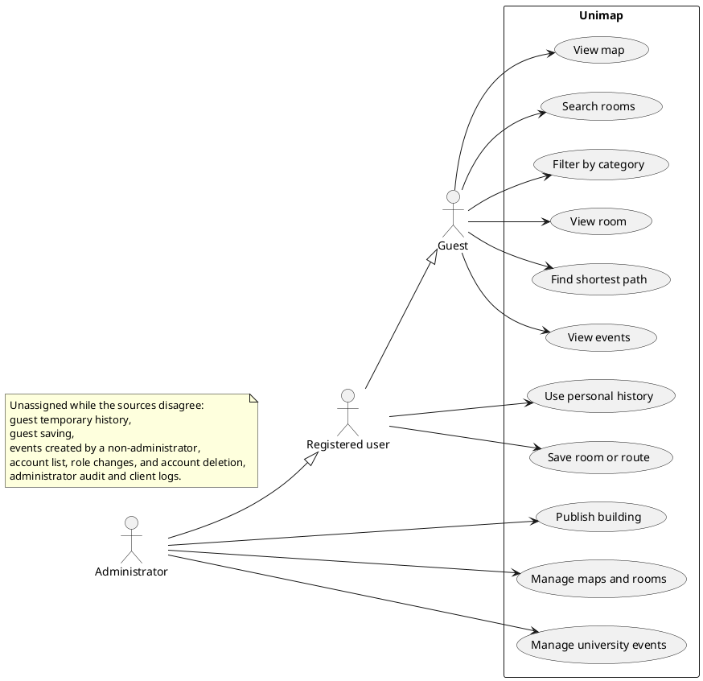
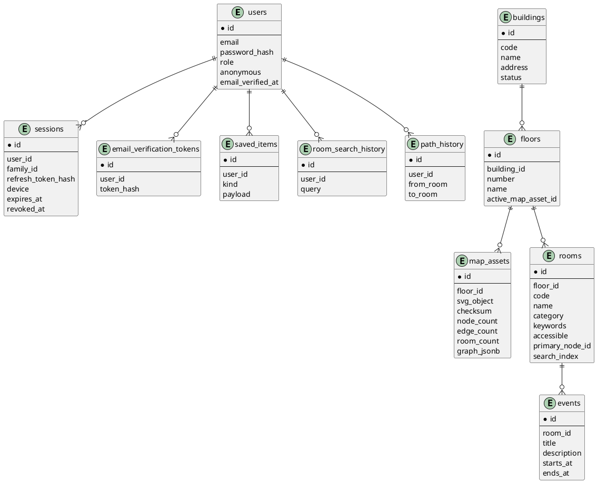
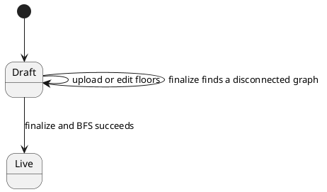
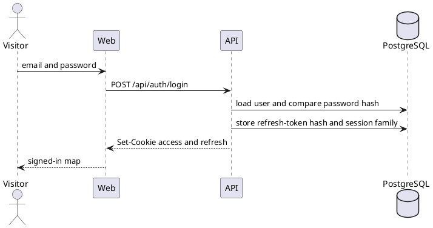
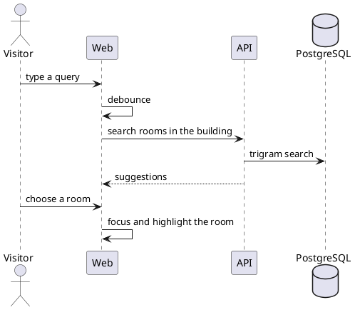
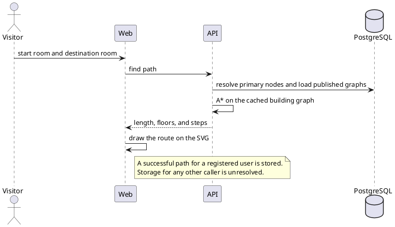

# Unimap specification

Unimap is a web application for indoor navigation inside a university. A visitor opens an interactive floor plan, searches for a room, filters rooms by category, and receives a shortest path that can cross floors. The institution keeps ownership of the map data.

This document is the product contract for the rebuild. The code baseline is `rebuild-stage-1`. `docs/github.txt` remains the stage-1 source URL and contains only `https://github.com/juis6world/unimap.git`. That repository stays unimported. The working origin is `https://github.com/zo-zu-lia/unimap.git`.

The behavioral contract below is the product. Implementation order is recorded in [roadmap.md](roadmap.md). The open slice scaffolds the applications named in that roadmap, a health route, and CI for typecheck and lint. It leaves authentication, maps, and Porto for later slices.

Structural drawings are in [architecture.md](architecture.md). Failure mapping is in [error-handling.md](error-handling.md). Graph-cache lifetime, the activation transaction, queue retries, and serialized token refresh are in [concurrency.md](concurrency.md). Where those files state one side of an item in [Unresolved disagreements](#unresolved-disagreements), this specification records the item and leaves the choice unrecorded.

## Unresolved disagreements

No developer selection is recorded for the five items below. Each item is a disagreement about the final product among the thesis, the diploma presentation, the Unimap 2.0 presentation, and the English product files. The behavior sections state the overlap that every one of those sources allows. They leave the extra claims listed here unselected.

### History ownership

A registered user has a personal search history and a personal route history. The sources disagree about everyone else.

- The thesis role section and the thesis history implementation give a guest a temporary search and route history on that guest account. Registration may attach that guest history to the new account. The thesis routing section stores each successful path request of an authorized user.
- The thesis use-case section lists personal history for the registered user and omits it from the guest's actions. The thesis history panel asks a person who is not signed in to sign in before stored history is shown. The thesis access design limits personal history and saved items to an authenticated user.
- [error-handling.md](error-handling.md) omits history from the guest capability list, returns HTTP 403 when a guest or a caller without a session requests personal history, and writes a successful route only for the registered user who requested it.
- [architecture.md](architecture.md) ties room-search history and path history to a user row, and the user roles include `guest`. It does not state an HTTP 403 for a guest history request. [concurrency.md](concurrency.md) gives a guest account and a registered account each a user row and a session family, and it does not state a history denial.
- The Unimap 2.0 presentation lists search and route history, including route replay, for students and guests, without this guest-versus-registered split.

### Saved items and event creation

A registered user can save rooms and routes. Any visitor who can view the map can view university events. An administrator can create, edit, and schedule those university events. The sources disagree about guest saving and about events created by a non-administrator.

- The Unimap 2.0 presentation, in stage 1 marked done, includes personal saved rooms and routes for students and guests, and it includes creation of personal events together with viewing of global events.
- The diploma presentation lists viewing and creating events as a user-facing capability, and it lists creation and scheduling of global events for the administrator. Its save slide lists personal saved rooms and routes for the user.
- The thesis gives saved rooms and routes to the registered user, and it gives creation and editing of university events to the administrator. It describes event viewing, date filtering, showing the event room on the map, and starting a route to that room.
- [architecture.md](architecture.md), [error-handling.md](error-handling.md), and [concurrency.md](concurrency.md) follow that thesis split. [error-handling.md](error-handling.md) returns HTTP 403 when a guest or a caller without a session requests saved rooms or saved routes, and it requires an administrator to create or change a university event. Those files do not describe personal events.

### Application layout

An API workspace and a visitor web client are common to the sources. The place of the administrator interface is unresolved.

- The thesis states that the npm workspaces are `apps/api` and `apps/web`, and it describes a separate administrator interface for map data.
- The Unimap 2.0 presentation, in stage 1 marked done, states three applications: `apps/api`, `apps/web`, and `apps/admin`.
- [architecture.md](architecture.md), [error-handling.md](error-handling.md), and [concurrency.md](concurrency.md) specify `apps/admin` as a separate Next.js application. [roadmap.md](roadmap.md) names those three directories in the open scaffold slice.
- A difference between the public repository named in `docs/github.txt` and the Unimap 2.0 presentation is outside this disagreement.

### Process boundary

The sources agree that the system has a client, an API, and a monorepo, and that the API is organized by domain modules. They disagree about the running process boundary.

- The diploma presentation lists client-server structure, a monorepo, and microservices together as properties of the architecture.
- The thesis describes one API application and one web client, with domain modules inside that API.
- The Unimap 2.0 presentation describes the current backend as a modular monolith and treats a Porto section as a boundary that can later become a separate service, with the navigation section given as the example under route-search load.
- [architecture.md](architecture.md) and [concurrency.md](concurrency.md) keep the API as one NestJS process. They place workers, the in-memory graph cache, and live updates in that process, and they place extraction of a Porto section outside the first slices.

### Administrator surface

Every source gives the administrator buildings, floors, map assets, rooms, and events. The sources disagree about accounts, audit, and client logs.

- The thesis limits administration to buildings, floors, maps, rooms, and events. Its module list names authentication, users, maps, rooms, wayfinding, history, events, notifications, and health. It does not describe an account-administration screen, an audit screen, or client-log intake.
- The diploma presentation adds a user list, role settings, and account deletion.
- The Unimap 2.0 presentation, in stage 1 marked done, adds those account operations and also an audit of administrator actions and client-log collection. The account operations use the roles `guest`, `user`, and `admin`.
- [architecture.md](architecture.md), [error-handling.md](error-handling.md), and the identity section of this specification's companion files include users, audit, and client logs on the administrator surface. [error-handling.md](error-handling.md) specifies the client-report batch and the audit record for the reading in which those screens exist.

## Functional specification

### Applications and stack

The API is NestJS 11 on Fastify. It exposes REST under `/api` and GraphQL through Mercurius, with DataLoader on aggregated reads. The visitor map is Next.js 15 on React 19 with the App Router. The Unimap 2.0 presentation and [architecture.md](architecture.md) place the administrator surface on that same frontend stack in `apps/admin`. The thesis names the workspaces `apps/api` and `apps/web` and describes a separate administrator interface. See [Application layout](#application-layout).

Shared technical choices named by the thesis, the Unimap 2.0 presentation, and the English files:

- TypeScript in strict mode, Node.js LTS, and npm workspaces.
- PostgreSQL 16 and Drizzle ORM. Floor graphs are stored as JSONB on versioned map assets. Room search uses a PostgreSQL trigram index.
- Redis 7 and BullMQ for mail and other background jobs. A local mail catcher is part of the development stack. The Unimap 2.0 presentation names Mailpit.
- S3-compatible object storage. MinIO is the local implementation. The API issues short-lived signed URLs for SVG sources.
- JWT access and refresh tokens in cookies, passwords hashed with bcrypt, and request throttling.
- Zod for environment, request, and form validation. Missing or invalid configuration prevents startup.
- Tailwind CSS 4 and Material Design 3 tokens, including light and dark themes.
- TanStack Query for server state and Zustand for interface state.
- next-intl for Ukrainian and English, with locale routing.
- react-zoom-pan-pinch for the map, react-hook-form for account forms, and axios with a refresh interceptor.
- Jest, end-to-end tests, ESLint, and Prettier.

Stage 1 server modules named across the thesis and the Unimap 2.0 presentation are authentication, users, maps, rooms, wayfinding, history, events, notifications, and health. Saved rooms and routes are a specified capability; the Unimap 2.0 presentation also names a `saved` module. Client logs are part of [Administrator surface](#administrator-surface).

Stage 2, as specified by the Unimap 2.0 presentation and [architecture.md](architecture.md), rearranges that behavior into Porto SAP containers and a ship layer. The container groups are identity, mapping, navigation, campus life, and platform. Campus life gains schedule and booking. Platform gains analytics. The process that hosts those containers is [Process boundary](#process-boundary).

### Map

The visitor selects a published building and sees the active floor as an SVG plan. The visitor pans, zooms, and switches floors. On a wide screen the tool panel sits at the side. On a narrow screen it collapses to a bottom bar. Search and the floor switch stay available at every width. Floor context is kept when the floor changes.

The map is loaded through a Next.js proxy that forwards cookies. The client sanitizes the SVG before inserting it into the page. A selected room is highlighted. A route is drawn by revealing the graph geometry that belongs to the computed steps, so the line follows corridors.

### Search, categories, and room details

Search matches room names and keywords inside the selected building and returns suggestions while the visitor types. The client debounces input. Results are ordered by relevance, and the trigram index tolerates typos. Choosing a suggestion focuses and highlights that room.

Category controls are multi-select. Choosing one or more categories highlights every room of those types on the current plan. Categories cover teaching rooms, laboratories, departments, cafeterias, restrooms, workspaces, and administrative offices.

Selecting a room opens a card with its name, category, floor, and the rest of its public metadata. From the card the visitor can start a route that uses that room. Saving the room follows [Saved items and event creation](#saved-items-and-event-creation).

### Wayfinding

The visitor chooses a start room and a destination room, with the same suggestion search used by the main search field. A room already chosen on the map fills the matching field. The server returns the shortest path, including a path that changes floors.

The result carries the start and destination room codes, their navigation nodes, total length, transition count, the floors crossed, and an ordered step list. Each step has a node identifier, a floor number, and the weight of the segment from the previous node. The client shows length and the floor list, and switching floors keeps the matching part of the route on screen.

A successful path request for a registered user is stored in route history. Storage for any other caller is [History ownership](#history-ownership).

### History and saved items

The product keeps two histories: room searches and built routes. When a history is shown, a person can replay an entry, delete one entry, or clear a history.

A registered user has a personal search history and a personal route history, and can save rooms and routes. Saved items open on the map or can be removed. Opening a saved route restores its floor and geometry. Opening a saved room focuses the map on that room.

Guest history, the sign-in invitation in the history panel, the HTTP 403 for a guest history request, and guest saving are [History ownership](#history-ownership) and [Saved items and event creation](#saved-items-and-event-creation).

### University events

Anyone who can view the map can view university events. An event has a title, a description, a start, an end, and a room. The list can be filtered by date. Choosing an event shows its room on the map and can start a route to that room.

An administrator can create, edit, and schedule these events. Creation by a student, a guest, or another non-administrator, including personal events, is [Saved items and event creation](#saved-items-and-event-creation).

### Administration of maps

An administrator manages buildings, floors, map assets, rooms, and events. Account lists, role changes, account deletion, administrator audit, and client logs are [Administrator surface](#administrator-surface).

A building has a unique code, a name, an address, and a publication state. The administrator creates it as a draft, uploads one SVG per floor, and edits room metadata after import. Each upload creates a new `map_assets` version with the SVG, a checksum, counts of nodes, edges, and rooms, and the parsed graph. A floor points at its active version. An older version can be activated again. Activating a version rewrites the room table from that graph in one database transaction. The Unimap 2.0 presentation and the diploma presentation also include deletion of a building.

Publication runs from draft through finalize to live. Stored status is draft or live. Finalize merges every floor graph and runs a breadth-first connectivity check. The building becomes live, and therefore visible to visitors, only when that merged graph is a single connected component. A failed check names the nodes that break connectivity and leaves the building unpublished. Draft data stays visible to administrators. A later activation that would disconnect a published building is rejected the same way, and the previous rooms and graph remain.

The SVG parser accepts the agreed markup and rejects DOCTYPE declarations, external entities, `script`, `foreignObject`, inline event handlers, and unsafe links.

## Map model

A floor plan is a weighted undirected graph carried in the same SVG that the client draws. Groups are marked as follows:

- `room` — a room, with a code, a label, a category, keywords, and a primary navigation node.
- `node` — a doorway, a corridor junction, or a vertical landing, with an identifier, a type, and coordinates taken from its geometry.
- `edge` — a walkable segment between two nodes. Its weight is the segment length. A source may also supply an explicit weight.

Vertical movement uses inter-floor nodes whose floor token is `00`. The same node identifier appears on every floor that landing connects. Merging floor graphs turns those shared nodes into bridges, so a multi-floor route is one path on the building graph.

Before publication, breadth-first search checks connectivity of each floor and of the merged building graph. Identifiers must follow the convention, every edge must end on existing nodes, and self-loops are rejected.

Routing uses A* on the cached merged graph of published floors. The cost is `f(n) = g(n) + h(n)`, where `g` is the weight from the start and `h` is the Euclidean distance between node coordinates. The heuristic is admissible, so the path is optimal. The open set is a binary min-heap. A node without coordinates uses a zero heuristic, and the search then behaves as Dijkstra. Start and goal are the primary navigation nodes of the two rooms.

Stage 1 treats an `00` node as stairs. Stage 2 types that node as stairs, elevator, or ramp and selects a cost function per route profile. The search algorithm stays A*.

Assumptions that bound correct behavior:

- Administrators supply SVG plans in the agreed markup.
- Geometry on one floor shares one coordinate system.
- A vertical connection is present, with the same identifier, on every floor it joins.
- The visitor uses a current browser with HTML5 and SVG.
- The deployment covers a modest number of buildings, so published graphs fit in memory and are cached.

## Stage 2 behavior

Stage 2 adds seven capabilities. The Unimap 2.0 presentation and this specification place each one in a new container or an extension of a stage-1 container. Existing route, map, and account behavior stays in place. The thesis does not deny these later capabilities. Their hosting process is [Process boundary](#process-boundary).

### Accessible routes and step-by-step guidance

A route profile describes a trip without stairs. Stairs are forbidden or penalized. Elevators and ramps remain usable. The profile is an input of path finding, and only the edge-cost function changes.

The product turns the path into localized steps from the angles between edges, such as a turn or a climb to a floor, and names nearby rooms as landmarks. The interface can speak steps, offer a high-contrast theme, and scale fonts, with a WCAG 2.2 AA target. The Unimap 2.0 presentation names the Web Speech API for spoken steps.

### Schedule and the next class

Schedule data is imported from iCal, CSV, or a faculty API and matched to room codes. A student follows a group. A teacher follows the courses they teach. The home screen shows the next class and builds a route from the current room in one action. BullMQ sends email and Web Push reminders a configured number of minutes before the class, and sends a notice when a class changes room.

### Occupancy and booking

Each room on the map shows whether it is free, occupied, or about to become free. The color combines the schedule, bookings, and events, and it updates through GraphQL subscriptions on Mercurius. A visitor can filter for a room that is free now or at a chosen time, and can filter by capacity and by equipment such as a projector or computers. Results can be sorted by distance from the visitor.

Student organizations and teachers submit booking requests. An administrator approves or rejects them. Overlapping requests for the same room are rejected. An approval updates the map and notifies the requester.

### QR positioning and the installed app

GPS is not the indoor position. An administrator generates a QR code for any graph node and prints sticker sheets as PDF. A code opens `/b/{building}/n/{node}` with that node already set as the route start. Scan counts feed later analytics.

The visitor app is installable. A service worker caches the active map versions and graphs, and the client can run A* offline on that cache. Web Push carries class and event reminders.

### Campuses and the walk outside

A campus sits above buildings and stores the outdoor coordinates of building entrances. A route between rooms in different buildings is the indoor path to an exit, a pedestrian path, and the indoor path from the other entrance. The pedestrian path uses OpenStreetMap routing. The Unimap 2.0 presentation names OSRM or GraphHopper for that segment, and Leaflet or MapLibre for the city map. The home page shows a city map with the buildings.

One deployment can host several institutions. Data is isolated by tenant, and each tenant has its own branding.

### Analytics

Administrators see a heatmap of searches and routes by floor, the most used rooms and routes, peak hours, searches with no result, and graph nodes that routes never cross. Usage events are collected on the queue and aggregated for the dashboard. The Unimap 2.0 presentation aggregates them in PostgreSQL materialized views.

### Map editor

An administrator can draw nodes and edges on top of a plan image, snap to a grid, and let the product compute edge weights. The editor highlights disconnected components while editing. A drawing moves through draft, check, and publish, keeps a full version history, and can be rolled back. Export writes the same SVG markup that stage 1 imports.

## Roles

The product has three roles: guest, registered user, and administrator. A registered user can do everything a guest can do. An administrator can use the visitor map and is the role that holds the administrative operations below.

### Guest

A guest can pan and zoom the map, switch floors, search, filter by category, open a room card, request a shortest path across floors, and view university events, without registering. Guest history and guest saving are unresolved. See [History ownership](#history-ownership) and [Saved items and event creation](#saved-items-and-event-creation).

### Registered user

A registered user can save rooms, save routes, and keep a personal search and route history. Event creation by this role is unresolved. See [Saved items and event creation](#saved-items-and-event-creation).

### Administrator

An administrator can manage buildings, floors, maps, rooms, and events. A user list, role changes, account deletion, administrator audit, and client logs are unresolved. See [Administrator surface](#administrator-surface).

Stage 2 adds administrator approval of bookings, QR generation, campus and tenant settings, the analytics dashboard, and the map editor. Students and teachers gain the schedule, booking requests, accessible profiles, and the installed app. Those additions keep the same three roles.

## UML

The diagrams below are the product UML, stored as Markdown text. They draw the overlap recorded in the functional specification. Claims that appear in [Unresolved disagreements](#unresolved-disagreements) stay in that section.

### Use cases

### Data model

The thesis data model is the diagram above. Stage 2 extends it with campuses and tenants above buildings, lessons, bookings, QR markers, and analytics aggregates. Administrator audit records and ingested client logs appear in the Unimap 2.0 presentation and in [architecture.md](architecture.md), and they are part of [Administrator surface](#administrator-surface).

### Publication states

Stored status is `draft` or `live`. Finalize is the connectivity step between them.

### Sign-in

### Room search

### Shortest path

## Identity management

### Accounts

Every account is a `users` row. The role is `guest`, `user`, or `admin`. A guest row is marked anonymous. A registered row stores an email, a bcrypt password hash, and the time email confirmation completed. Passwords are stored only as hashes. Refresh tokens are stored only as bcrypt hashes.

Public map, search, path, and event reads are available to every visitor. Personal history and saved items for a registered user are specified above. Administrative map and event operations require the `admin` role. The open parts of history, saving, event creation, and the administrator surface stay in [Unresolved disagreements](#unresolved-disagreements).

### Registration and email confirmation

Registration creates an unconfirmed user and a one-time verification token. The token is stored as a hash. BullMQ sends the confirmation mail, so the HTTP response does not wait for delivery. The confirmation link consumes the token, sets the session cookies, and returns the person to the application already signed in. A password sign-in before confirmation is rejected. The status mapping is in [error-handling.md](error-handling.md).

Sign-in and registration share one dialog with two tabs. Forms show validation as the person types.

Guest entry creates an anonymous `guest` account and a session. The thesis describes that row so the product can hold data for the guest before registration. Which of those data are in the product is [History ownership](#history-ownership) and [Saved items and event creation](#saved-items-and-event-creation).

### Sessions

Authentication uses a short-lived access token and a long-lived refresh token. The access token lasts 15 minutes. The refresh token lasts 30 days. Both travel in `HttpOnly` cookies. The access payload carries the user identifier, the role, and the session identifier, which is enough to authorize a request without reading the user row on every call.

Refresh tokens belong to families. Each refresh revokes the presented session and issues a new one. Reuse of a revoked refresh token revokes the whole family.

Logout revokes the current session. The web client, on an unauthorized response, refreshes once and retries the original request. Concurrent refreshes in one tab are serialized. The serialization rule is in [concurrency.md](concurrency.md).

### Authorization

Global guards read the access cookie and compare the role with the route policy. Public routes, guest-allowed routes, and role-restricted routes are declared on the handlers. The thesis names the policies with public, guest-allowed, and role decorators.

The administrator interface is limited to the `admin` role. Whether that interface is a third application is [Application layout](#application-layout). Whether it includes account administration, audit, and client logs is [Administrator surface](#administrator-surface).

### Stage 2 identity scope

Schedule subscriptions attach a student to a group and a teacher to courses. Booking requests are submitted by student organizations and teachers and decided by an administrator. Multi-tenant deployments isolate accounts and map data by tenant. Those rules extend the same three roles. They do not add a fourth role.

## Quality and operating constraints

The interface is Ukrainian and English, responsive, and usable with keyboard, pointer, and touch. Stage 2 adds the accessible route profile, speech, contrast, and font scaling described above.

Published graphs are connected. Route responses stay fast by caching the merged graph and by caching stable reads such as the building list and the category list. The client cache avoids repeat reads. Large SVG files are fetched from object storage through signed URLs. Cache lifetime and the single-process cache described by the English files are in [concurrency.md](concurrency.md), subject to [Process boundary](#process-boundary).

Domain failures, including an unknown building, a missing path, and bad credentials, surface as consistent API errors. The global mapping of those failures is specified in [error-handling.md](error-handling.md). Where that file denies guest history, denies guest saving, or reserves event creation for an administrator, the denial is one side of [Unresolved disagreements](#unresolved-disagreements).

Automated coverage includes authentication, map upload and validation, A*, filtered search, and the cross-floor path. The suite is unit, integration, and end-to-end tests, plus manual passes in more than one browser and at more than one viewport width.

## Boundaries

Porto SAP in stage 2 is the ship layer and the containers. A request handler validates input and calls one action. An action orchestrates tasks. A task performs one reusable operation and is the only caller of a repository. Containers call each other through actions or events. The Unimap 2.0 presentation and [architecture.md](architecture.md) describe that layout inside the NestJS application. Whether the running system is that single process or the microservices named by the diploma presentation is [Process boundary](#process-boundary).

The first slices leave Notion, Figma, Datadog, and a database MCP out of the product. Merge and deploy stay human actions.
